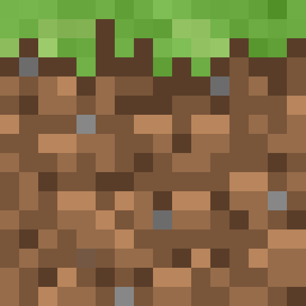

<h1>
  
  Serveur Minecraft Fabric pour YunoHost
</h1>

Serveur Minecraft Fabric (chargeur de mods léger) packagé pour YunoHost, avec BlueMap (carte 3D en direct) et VoxCP/SCP optionnels pour la gestion à distance.

**Version livrée :** voir manifest.toml (minecraft + fabric + mods)

## Caractéristiques

- Serveur Fabric natif avec service systemd
- Carte 3D BlueMap servie par nginx (protégée par le portail YunoHost)
- VoxCP/SCP (console d'administration) optionnels
- Monde et configuration persistants (data_dir)

## Liens

- Fabric : <https://fabricmc.net>
- BlueMap : <https://bluemap.bluecolored.de>
- Paquet YunoHost : <https://github.com/quartztester/minecraftfabric_ynh>

## Screenshots

